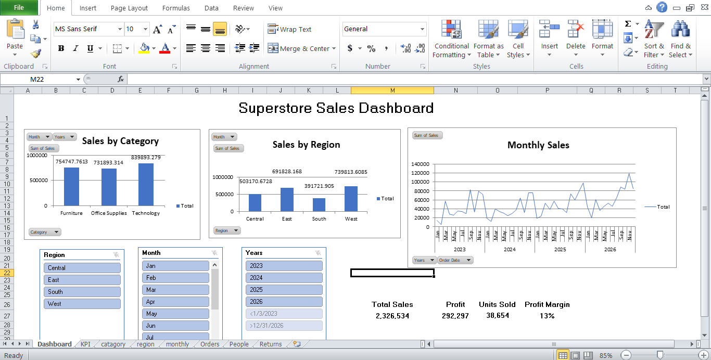

# Superstore Sales Dashboard

## Overview
Interactive Excel dashboard showing sales performance by
category, region and month using the Sample Superstore dataset.

## Tools Used
Microsoft Excel (PivotTables, PivotCharts, Slicers)

## Features
- 4 KPIs: Total Sales, Profit, Units Sold, Profit Margin
- 3 visuals: Sales by Category, Sales by Region, Monthly Sales trend
- Slicers for Region and Month to filter the dashboard

## Files
- SuperstoreDashboard.xlsx: dashboard file
- final dashboard.png: screenshot
- How_to_read_dashboard.pdf: one-page guide

## Key Insights
- West region had the highest sales
- Technology was the top category
- (add your own insight)

## Screenshot

